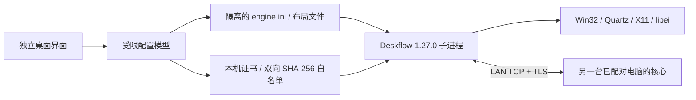

# DeskBridge 产品与开发设计

2026-10-13。目标用户是在同一桌面、同一局域网使用多台 Windows、Mac 与 Ubuntu 电脑的单一所有者。产品传输输入事件与可选剪贴板；每台电脑使用自己的显示器，不传输桌面视频。

## 设计选择

MVP 以独立 Python/Tk 桌面界面管理官方固定版本 Deskflow 核心。Synergy 的难点集中在原生 hooks、按键布局、边缘几何、macOS 权限及 Wayland portals。复用开源核心能先交付真实功能；独立产品若选择完全重写，应把输入后端与协议开发作为单独阶段，而不是替换几个 UI 标签。

首版管理层不新增 HTTP 服务，不自动下载或执行网络返回的内容。核心使用普通用户权限，不注册系统服务。启动失败时显示真实错误；修改布局或信任列表前须停止核心。

## 模块与契约

| 模块 | 责任 |
|---|---|
| model.py | 设备名、操作系统、局域网地址、网格、指纹与配置 schema 校验 |
| identity.py | RSA-3072 本机身份、有效期校验、公开 SHA-256 指纹 |
| storage.py | 私有目录、原子写入、单实例文件锁 |
| core.py | 固定版本校验、1.27 settings 与链接文件生成、受限子进程、日志队列、停止 |
| gui.py | 布局拖动、双方配对、启停和可见运行状态 |
| cli.py | 环境诊断、身份显示、配置预生成与终端运行 |
| discovery.py | 有界 mDNS 元数据解析、按身份主动查询与重试、系统电脑名备用寻址、DHCP 网卡更新 |
| process_env.py | 隔离原生子核心和冻结 Python 的运行库搜索环境 |

1.27 的电脑列表放在 engine.ini 的 `[computer_NAME] name=NAME`；链接和热键在 server.conf。旧版 `section: screens` 已被核心忽略，不能沿用旧教程。剪贴板容量由 `server/clipboardSize=1024`（KiB）设置；设置值不是源码老版本的 clipboardSizeLimit。

Windows 必须使用 portable 引擎，否则上游 `Settings::settingsPath()` 可落到 ProgramData，单用 `--settings` 不保证信任文件隔离。现实现检查 `settings/Deskflow.conf` 存在，且回环测试检查实际读取的白名单目录。

0.2.0 删除 IPv4 输入框；设备身份与 DHCP 地址分离。mDNS 服务 `_deskbridge._tcp.local.` 发布公开指纹、名称、系统、角色、端口及当前私有网卡地址。网卡地址变化时注销旧广播、重新建立发现接口；接收端发现所配对共享端端点变化后重新启动连接，白名单不变。多网卡优先使用共享子网；同一组播网络是自动发现的运行条件。

0.2.1 在无组播记录时通过系统解析已配对电脑名，以补充跨网段寻址。单个后台 DNS 线程与有界请求表负责解析，调用方仍有 8 秒启动截止时间；仅接受全部为 RFC1918 的 IPv4 结果，不跟随 URL、不接受环回或公网，不持久化 DHCP 地址。实际连接沿用已配对证书 pin，DNS 与 mDNS 都不能授信。若发现名称、角色或指纹冲突，则给出明确错误，不以 DNS 掩盖冲突。首次 mDNS 记录查询失败仍会重试，并可按已配对指纹构造服务实例名主动查询；角色切换立即触发广播更新。

打包时将官方原生核心完整复制到 EXE 旁的 `engine/`，不交给 PyInstaller 的 Python 依赖扫描器。外部程序启动前恢复系统 DLL 搜索规则，并在进程创建后恢复父程序的规则。这样独立核心的 Qt、ICU、OpenSSL 与 Python 的 DLL 不会混用。

## 交互

本机身份生成 → 复制公开指纹 → 在对端屏幕核对 → 添加设备 → 布局相邻 → 一台共享、其他接收 → 系统权限授权 → 启动。失败信息对应版本、配对、网卡地址、证书、系统权限及核心退出原因。

信任是对整个工作区授权。电脑名方便布局导航，不代表独立的资源权限。首版默认关闭剪贴板，启用后由所有已配对设备共同使用。

## 支持与验收

| 能力 | MVP 实现 | 发布验收要求 |
|---|---|---|
| 跨电脑键鼠 | 复用原生核心 | Win↔Mac、Win↔Ubuntu、Mac↔Ubuntu 双向测试 |
| 屏幕切换 | 相邻格生成双向 links | 多屏负坐标、DPI 100/150/200%、鼠标拖动与回切 |
| 按键映射 | 核心平台后端 | Ctrl/Cmd/AltGr、中文输入法、按键重复、断连释放 |
| 双向配对 | 完整 SHA-256 白名单 | 未配对拒绝、指纹变更拒绝、移除后拒绝 |
| 剪贴板 | 默认关闭，启用后 1 MiB | 文本/图像、超限拒绝、Wayland 库缺失的反馈 |
| Ubuntu Wayland | 条件继承 libei/portal | GNOME 与 KDE，各自授权、重登、休眠与多屏 |
| 生命周期 | 有界队列、单实例、启停 | 核心崩溃、UI 异常退出、网络断开后不保留输入锁 |

后续阶段：先完成三平台实机矩阵与核心 IPC 最小权限修复，再做签名安装包/托盘/自启动；随后做二维码交换（发现不授信）与受控跨网段连接；最后再考虑 Rust 核心重写、证书到设备名的强制绑定、多用户隔离与企业管理。

若重写核心：UI 可以转为 Qt/QML 或 Tauri；Rust 管理会话与有界协议解析，平台适配层分别实现 Win32、Quartz、X11、libei + portals。仍需保留显式系统授权、TLS 身份绑定、输入释放和断连超时；不能通过 uinput root、UAC 绕过或关闭权限控制来统一平台差异。
