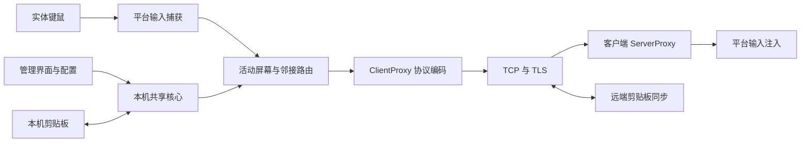

# Synergy 分析与 DeskBridge MVP 设计依据

分析日期：2026-10-13（Asia/Shanghai）。结论：Synergy 的可复用能力主要来自原生输入共享核心。跨 Windows、macOS、Ubuntu 的 MVP 适合采用独立管理界面与官方 Deskflow 核心进程分离的结构；输入捕获、注入、按键映射、屏幕切换与剪贴板保持由核心执行。

## 1. 证据范围与限制

本报告依照 reverse-engineer-anything 的证据区分方法，但分析对象是完整官方源码，因此使用正常仓库工具，无需反编译或 REA 原生会话。

本次静态读取目标为 `D:\codex\synergy-analysis\upstream`，已用 `git rev-parse HEAD` 确认提交 `9bf510d048be9a73ee113cdc80563e1ec5b82b42`。以下路径与行号均指该提交。未修改该仓库，未执行其输入捕获、网络监听或平台服务。没有取得本机 Synergy 二进制，也没有读取残留日志中的输入内容、设备标识或凭证。因此不能声称完成 Synergy 商业安装包、Synergy 3 界面、登录服务或运行时逆向。

三个证据层应分开使用：

| 类型 | 本次证据 | 能支持什么 |
| --- | --- | --- |
| 已观察源码 | 固定 Synergy commit 的源码与配置 | 调用关系、平台 API、分支条件与协议定义 |
| 官方资料 | 2026-10-13 访问的 Symless 帮助页、Deskflow 1.27.0 发布页 | 厂商声明、支持条件、版本发布内容 |
| 设计推断 | 基于上述材料提出的 DeskBridge 方案 | MVP 选型与验收要求；不是已完成的运行结果 |

仓库 [README.md:11](D:/codex/synergy-analysis/upstream/README.md:11) 说明它包含 Synergy 1 与 Synergy 3 Core，基于 Deskflow。该提交 [CMakeLists.txt:24](D:/codex/synergy-analysis/upstream/CMakeLists.txt:24) 的基线版本变量仍为 Deskflow 1.26.0，另有 Synergy 覆盖与移植。因此本报告不将这个提交与拟采用的 Deskflow 1.27.0 二进制视为相同构建。

## 2. 结构与数据流

已观察：共享键鼠的电脑为 primary/server，其他电脑为 secondary/client。Server 管理当前活动屏幕、屏幕邻居关系与剪贴板所有者；ClientProxy 将动作编码到连接，Client/ServerProxy 接收并调用平台 Screen。平台选择直接位于 [ServerApp.cpp:390](D:/codex/synergy-analysis/upstream/src/lib/deskflow/ServerApp.cpp:390) 与 [ClientApp.cpp:105](D:/codex/synergy-analysis/upstream/src/lib/deskflow/ClientApp.cpp:105)。

协议使用固定消息类型而不是逐帧传输桌面画面。观察到 [ProtocolTypes.cpp:18](D:/codex/synergy-analysis/upstream/src/lib/deskflow/ProtocolTypes.cpp:18) 定义 `CINN`/`COUT`、`DKDN`/`DKUP`、`DMMV`/`DMRM`、`DMWM`、`DCLP`、`DINF`、`CALV` 等。版本常量为协议 1.8，见 [ProtocolTypes.h:37](D:/codex/synergy-analysis/upstream/src/lib/deskflow/ProtocolTypes.h:37)。存在向旧版本代理适配代码，不等于任意 Synergy、Barrier、Input Leap 或 Deskflow 版本均能互通；MVP 应固定所有电脑使用同一 Deskflow 版本，不作未经验证的兼容承诺。

## 3. 输入捕获、注入与平台边界

| 平台 | 已观察源码 | 实现含义 | MVP 约束 |
| --- | --- | --- | --- |
| Windows | [MSWindowsHook.cpp:637](D:/codex/synergy-analysis/upstream/src/lib/platform/MSWindowsHook.cpp:637) 安装 `WH_MOUSE_LL`、`WH_KEYBOARD_LL`；[MSWindowsDesks.cpp:85](D:/codex/synergy-analysis/upstream/src/lib/platform/MSWindowsDesks.cpp:85) 用 `SendInput` 发送键鼠；[MSWindowsKeyState.cpp:1174](D:/codex/synergy-analysis/upstream/src/lib/platform/MSWindowsKeyState.cpp:1174) 转换虚拟键、扫描码与 flags | 全局输入捕获与原生注入；存在 Windows desktop 管理 | 默认以当前用户运行。MVP 不承诺登录屏、UAC、安全桌面或管理员窗口的完整输入能力；这些需要另行验证服务与权限边界 |
| macOS | [OSXScreen.mm:211](D:/codex/synergy-analysis/upstream/src/lib/platform/OSXScreen.mm:211) 检查 `AXIsProcessTrusted`；[OSXScreen.mm:782](D:/codex/synergy-analysis/upstream/src/lib/platform/OSXScreen.mm:782) 创建 event tap；[OSXScreen.mm:576](D:/codex/synergy-analysis/upstream/src/lib/platform/OSXScreen.mm:576) 与 [OSXKeyState.cpp:667](D:/codex/synergy-analysis/upstream/src/lib/platform/OSXKeyState.cpp:667) 使用 `CGEventPost` | 依赖辅助功能授权与 Quartz 输入机制，存在 Secure Input 处理 | 权限需要授予实际执行输入的核心程序；不能只对 Python/Tkinter 界面授权。签名、应用路径变化、权限撤销与 Secure Input 均应纳入实机验收 |
| Ubuntu X11 | [XWindowsScreen.cpp:1861](D:/codex/synergy-analysis/upstream/src/lib/platform/XWindowsScreen.cpp:1861) 使用 `XGrabKeyboard`/`XGrabPointer`；[XWindowsScreen.cpp:769](D:/codex/synergy-analysis/upstream/src/lib/platform/XWindowsScreen.cpp:769) 使用 XTest；[XWindowsKeyState.cpp:279](D:/codex/synergy-analysis/upstream/src/lib/platform/XWindowsKeyState.cpp:279) 注入键盘 | 依赖本机 X server 连接与 XTest | 以普通桌面用户运行，在其 DISPLAY/XAUTHORITY 会话中启动，不用 root 绕过桌面权限 |
| Ubuntu Wayland | [EiScreen.cpp:57](D:/codex/synergy-analysis/upstream/src/lib/platform/EiScreen.cpp:57) 区分 InputCapture 与 RemoteDesktop portals；[EiScreen.cpp:135](D:/codex/synergy-analysis/upstream/src/lib/platform/EiScreen.cpp:135) 分别创建 libei receiver/sender；[PortalInputCapture.cpp:366](D:/codex/synergy-analysis/upstream/src/lib/platform/PortalInputCapture.cpp:366) 与 [PortalRemoteDesktop.cpp:147](D:/codex/synergy-analysis/upstream/src/lib/platform/PortalRemoteDesktop.cpp:147) 连接 EIS | 服务器使用 portal 捕获，客户端使用 portal 注入；构建与 compositor 能力均影响运行 | 不应将 Tkinter 的 XWayland 窗口误判为核心只支持 X11。需保留用户确认系统权限弹窗的流程，权限拒绝后明确报错并停止核心 |

未知：本机没有 macOS/Ubuntu 会话与第二台测试机，未观察上述 API 在目标环境中的真实行为。当前 Windows 的普通用户核心能否满足所有提升权限程序也未实测。

## 4. 屏幕切换与多显示器

已观察：服务端把活动屏幕边界坐标转换为边缘比例，再映射到邻居屏幕像素，见 [Server.cpp:517](D:/codex/synergy-analysis/upstream/src/lib/server/Server.cpp:517)；`getNeighbor` 会跳过未连接的屏幕，见 [Server.cpp:573](D:/codex/synergy-analysis/upstream/src/lib/server/Server.cpp:573)。切换流程调用旧屏幕 `leave()`，更新活动对象并进入目的屏幕，见 [Server.cpp:401](D:/codex/synergy-analysis/upstream/src/lib/server/Server.cpp:401)。主屏幕鼠标事件在 [Server.cpp:1694](D:/codex/synergy-analysis/upstream/src/lib/server/Server.cpp:1694) 判断越界与邻居。

多显示器不是把每块物理显示器注册为一台网络电脑。Windows 用虚拟桌面边界 [MSWindowsScreen.cpp:1483](D:/codex/synergy-analysis/upstream/src/lib/platform/MSWindowsScreen.cpp:1483)，macOS 聚合活动显示器 [OSXScreen.mm:1498](D:/codex/synergy-analysis/upstream/src/lib/platform/OSXScreen.mm:1498)，X11 查询 Xinerama 与监听 XRandR [XWindowsScreen.cpp:877](D:/codex/synergy-analysis/upstream/src/lib/platform/XWindowsScreen.cpp:877)。Wayland 依据 portal 的 per-output zones，再映射到核心按“整个电脑一个屏幕”建模的坐标空间，见 [PortalInputCapture.cpp:514](D:/codex/synergy-analysis/upstream/src/lib/platform/PortalInputCapture.cpp:514)。该实现只为组合桌面的外沿设置 barriers，以避免内部显示器边缘导致 portal 拒绝，见 [PortalInputCapture.cpp:924](D:/codex/synergy-analysis/upstream/src/lib/platform/PortalInputCapture.cpp:924)。

设计推断：DeskBridge 布局应明确每个方块表示一台电脑，先支持整数网格的上下左右邻接；物理显示器拓扑与混合 DPI 的处理交给核心。名称应固定、唯一，运行中变更布局/身份采用停止→保存→重新启动，避免配置与活动连接不一致。不可声称已经验证 L 形桌面、跨比例缩放、负坐标或休眠后热插拔。

## 5. 剪贴板

已观察：[ClipboardTypes.h:26](D:/codex/synergy-analysis/upstream/src/lib/deskflow/ClipboardTypes.h:26) 区分普通剪贴板与 selection；[IClipboard.h:59](D:/codex/synergy-analysis/upstream/src/lib/deskflow/IClipboard.h:59) 定义文本、HTML、位图及多个富文本/图片格式。不同平台通过各自 converter 和剪贴板 API 转换。Wayland 的 InputCapture 当前仅处理普通 clipboard，见 [PortalInputCapture.cpp:250](D:/codex/synergy-analysis/upstream/src/lib/platform/PortalInputCapture.cpp:250)。

Server 跟踪所有者、进入屏幕的序列号，丢弃旧序列更新 [Server.cpp:1188](D:/codex/synergy-analysis/upstream/src/lib/server/Server.cpp:1188)。实际数据经分块发送；该提交接收侧检查声明大小、实际大小与上限，见 [ClipboardChunk.cpp:80](D:/codex/synergy-analysis/upstream/src/lib/deskflow/ClipboardChunk.cpp:80)。服务端发送前也检查最大大小 [Server.cpp:1468](D:/codex/synergy-analysis/upstream/src/lib/server/Server.cpp:1468)。为减小大剪贴板对输入的影响，观察到待鼠标停止后同步、按键或点击前提前同步的逻辑 [Server.cpp:1506](D:/codex/synergy-analysis/upstream/src/lib/server/Server.cpp:1506)。

设计推断：管理界面应提供显式开关与有限大小设置，不采集、预览或持久化剪贴板正文，不用嵌入网页执行收到的 HTML/SVG。跨平台富文本粘贴质量与全部格式兼容仍需实测。文件拖拽协议常量存在不能证明文件传输是受支持功能，MVP 不纳入文件传输。

## 6. TLS、信任边界与授权

已观察：TCP/TLS 与 peer authorization 是不同设置。[ServerApp.cpp:441](D:/codex/synergy-analysis/upstream/src/lib/deskflow/ServerApp.cpp:441) 在 `security/tlsEnabled` 与 `security/checkPeerFingerprints` 同时为真时使用 `SecurityLevel::PeerAuth`；单开 TLS 只进入 Encrypted 模式，服务端并不执行 client 指纹白名单检查。

TLS 代码禁用 TLS 1.2 之前的协议 [SecureSocket.cpp:369](D:/codex/synergy-analysis/upstream/src/lib/net/SecureSocket.cpp:369)。PeerAuth 请求客户端证书，再以 SHA-256 证书摘要检查本机白名单。它有意绕开普通 CA 证书链验证，而不是关闭所有身份验证；身份信任来自后续 fingerprint pinning。服务端检查位于 [SecureSocket.cpp:450](D:/codex/synergy-analysis/upstream/src/lib/net/SecureSocket.cpp:450)，客户端检查位于 [SecureSocket.cpp:513](D:/codex/synergy-analysis/upstream/src/lib/net/SecureSocket.cpp:513)。缺少证书、空库、未匹配指纹会拒绝，见 [SecureSocket.cpp:637](D:/codex/synergy-analysis/upstream/src/lib/net/SecureSocket.cpp:637)。因此不应把它描述为 HTTPS 式 CA/域名认证，也不应在新产品中自行抄写一个忽略证书验证的 TLS 客户端。

数据库中的指纹条目为 `v2:sha256:<64 位小写十六进制>`，见 [Fingerprint.cpp:24](D:/codex/synergy-analysis/upstream/src/lib/net/Fingerprint.cpp:24)。数据库文件为 settings 路径下的 `tls/trusted-servers` 与 `tls/trusted-clients`，见 [Settings.cpp:281](D:/codex/synergy-analysis/upstream/src/lib/common/Settings.cpp:281)。Windows 非 portable 路径存在 SystemDir 特例，故“传入 --settings 就一定完全隔离”的假设必须用真实 Deskflow 版本验证，不可仅依赖该 Synergy 源码推断。

屏幕名称检查在 TLS 之后的协议层：[ClientProxyUnknown.cpp:207](D:/codex/synergy-analysis/upstream/src/lib/server/ClientProxyUnknown.cpp:207) 从握手读名称，[Server.cpp:258](D:/codex/synergy-analysis/upstream/src/lib/server/Server.cpp:258) 要求名称在配置中且唯一。指纹库只检查集合成员 [FingerprintDatabase.cpp:84](D:/codex/synergy-analysis/upstream/src/lib/net/FingerprintDatabase.cpp:84)，本次链路未观察到“证书指纹→特定屏幕名”的强制绑定。因此，MVP UI 可保存名称与指纹供用户核对，但不能声称核心已强制逐屏幕授权；受信任设备应视为同一信任域。若要求多租户、逐电脑角色/权限或强制身份名称绑定，则需另行实现并评审核心/代理机制。

建议的 MVP 控制：

1. 每台电脑独立生成本地证书与私钥，私钥留在当前用户应用目录，POSIX 权限收敛、Windows ACL 依赖用户目录并核对继承；配置不得含预置私钥。
2. 两端经独立渠道核对 SHA-256 指纹后分别写入受信库；未知证书拒绝，证书变更不自动接受，重新核对后才替换。
3. 启动前检查 TLS 与 peer 检查均启用；发现不兼容核心版本或缺少受信项时阻止连接，不回退明文。
4. 显式指定监听地址与端口，限定局域网用途；不在 MVP 新增云中继、mDNS 信任或自动防火墙开放。
5. Python 仅启动固定核心可执行文件及参数数组，不使用 shell 拼接。名称、地址、端口、布局与指纹均做严格字段验证，避免核心配置注入。
6. 状态日志使用 INFO 级并限制内存/文件增长，不输出键值、剪贴板正文或 PEM 私钥；断开后由核心释放输入状态，管理进程关闭时停止其子进程。

这不是完整安全审计；此处描述观察到的边界与相关开发约束，不作“无漏洞”结论。

## 7. 官方资料与源码结论分别使用

2026-10-13 访问的 [Synergy Security and Architecture Overview](https://support.symless.com/hc/en-us/articles/48326695360529-Security-and-Architecture-Overview)（2026-10-03 更新）称输入流在局域网直连、TLS 最低 1.2、身份基于证书指纹。它也说明 Synergy 3 另有服务/设置连接，Windows 服务权限与默认诊断日志会影响边界。这些是对应商业版本的厂商声明，不是本次二进制验证结果。

[Synergy Wayland support on Linux](https://support.symless.com/hc/en-us/articles/35748398109841-Wayland-support-on-Linux)（2026-10-07 更新）将 Wayland 支持列为实验，限定 GNOME 46+ 或 KDE Plasma 6.1+ 与合适 libei/portal。该页列 Ubuntu 22.04 包只支持 Xorg，并称新版 portal 剪贴板需要 libportal 0.10.0；Ubuntu 26.04 的旧 libportal 不具备对应能力。因此不能笼统保证所有 Ubuntu 桌面完整支持。

[Deskflow v1.27.0 官方发布页](https://github.com/deskflow/deskflow/releases/tag/v1.27.0) 为 2026-10-01 发布，包含 Wayland 剪贴板/多显示器、设置重构、真实 IPC、输入释放和连接修复。MVP 固定此版本时，应读取该 tag 的实际设置键和命令行参数，并以下载包自检验证；不要直接搬用旧 `synergys`/`synergyc` 参数。

本报告未分析或复制 Synergy 商业许可、账户、激活机制。开源核心的许可声明可在文件头观察到 `GPL-2.0-only WITH LicenseRef-OpenSSL-Exception`；交付与再分发应保留实际 Deskflow 构建所附许可和源码提供要求。正式商业再分发的许可组合需人工确认，本报告不作法律适用结论。

## 8. DeskBridge MVP 设计与验收边界

设计选择为 Python/Tkinter 管理界面 + 官方 Deskflow 1.27.0 原生核心。管理界面负责主机/客户端模式、电脑名称、服务器地址、屏幕网格、剪贴板开关、证书指纹信任、启动/停止与有限诊断。核心进程负责完整键鼠共享。以进程边界复用原生后端，能避免在 Python 内重新实现系统 hooks 与键盘布局映射。

交付能力应区分：管理界面能启动；核心正确读取独立配置；真实两机已建立 TLS 互信；键鼠在对应 OS 组合上真实切换。这四项相互不能替代。单机 `--help`、配置测试、Tkinter 窗口显示或协议静态检查均不能证明跨机操作已经验证。

| 原始问题 | 状态 | 依据与剩余验证 |
| --- | --- | --- |
| Windows/macOS/Ubuntu 输入实现 | 静态已回答，运行部分未验证 | 原生 API 调用明确；需三平台核心实际启动、权限、注入与捕获验收 |
| 边缘切换与多显示器 | 静态已回答，复杂布局未验证 | Server 坐标比例映射与平台聚合；需混合 DPI、负坐标、热插拔、L 形显示器测试 |
| 剪贴板 | 部分回答 | 所有权、序列、格式与大小限制明确；需跨 OS 文本/图片粘贴和 Wayland portal 检查 |
| TLS 双向信任 | 静态已回答，实际版本需验证 | 两端白名单逻辑明确；需未知指纹拒绝、已知指纹成功、变更指纹拒绝与实际配置隔离测试 |
| Synergy 3 商业界面/服务 | 未进行逆向 | 无目标二进制，官方文档只能提供背景 |
| 完整平台支持声明 | 未成立 | 当前未进行 macOS 与 Ubuntu 实机、两台电脑端到端验收 |

后续最低实机验收包含：Windows→macOS、Windows→Ubuntu、macOS→Ubuntu 双角色；每种组合检查移动、按键、修饰键、滚轮、剪贴板；拒绝未信任端；拔网线/睡眠/停止核心后释放键鼠；Wayland 拒绝权限时仍可在本机正常使用；Windows 不误宣称安全桌面支持。测试完成前，应在 README 明示尚未验证的组合。

安全自查：本报告仅做相关源码静态分析与设计建议，未改变上游安全设置；已记录 TLS 双向校验、全局指纹信任域、平台权限与尚需实机/人工确认的边界，未声称安全审计或运行测试通过。
